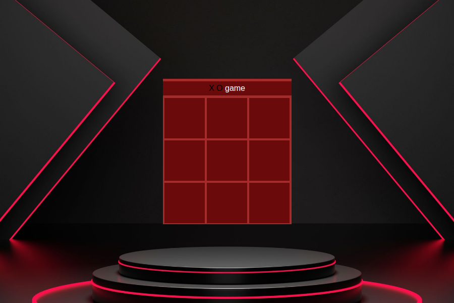
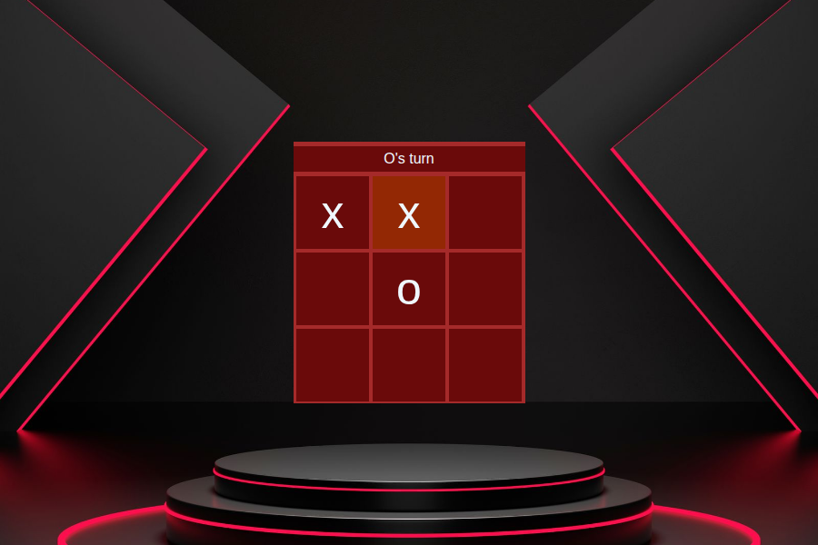
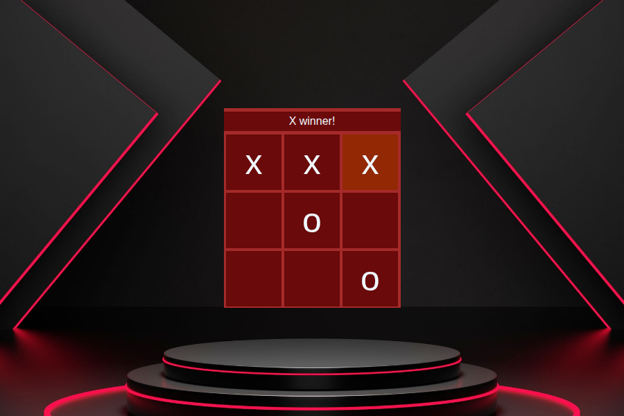
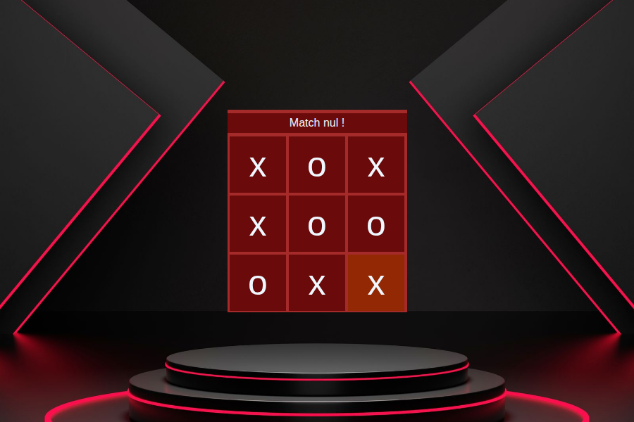

# 🎮 Jeu X O (Tic-Tac-Toe)

Mini TP JavaScript : un jeu de morpion à deux joueurs, en HTML / CSS / JavaScript pur (sans librairie).



## ✨ Fonctionnalités

- Deux joueurs en alternance : **X** commence, puis **O**
- Le titre indique à qui est le tour
- Détection de la victoire (3 lignes, 3 colonnes, 2 diagonales)
- Détection du **match nul**
- Impossible de jouer sur une case déjà prise
- Le jeu se bloque à la fin, puis la page se recharge après 3 secondes

## 📸 Aperçu

| Partie en cours | Victoire | Match nul |
|:---:|:---:|:---:|
|  |  |  |

## 🚀 Lancer le jeu

1. Télécharger ou cloner le projet :
   ```bash
   git clone https://github.com/TON-PSEUDO/NOM-DU-REPO.git
   ```
2. Ouvrir `index.html` dans un navigateur (double-clic).

## 📁 Structure du projet

```
├── index.html      # structure de la page + logique JavaScript
├── style.css       # mise en forme
├── images/         # image de fond + captures d'écran
└── README.md
```

## 🧠 Comment ça marche

- Chaque case est une `div` avec un `id` (`item1` à `item9`).
- `game(id)` place le symbole du joueur courant et change de tour.
- `winner()` lit les 9 cases et compare les 8 combinaisons gagnantes.
- `fin(message)` affiche le résultat, bloque le jeu et recharge la page.

## 🛠️ Technologies

HTML5 · CSS3 (Grid) · JavaScript

## 👤 Auteur

Ton nom — mini TP JavaScript
